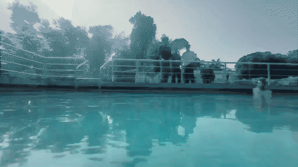
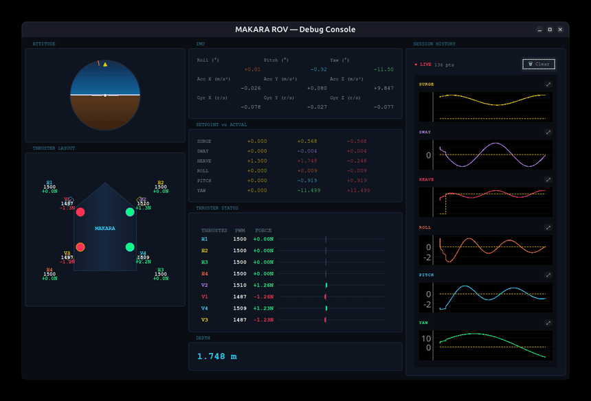
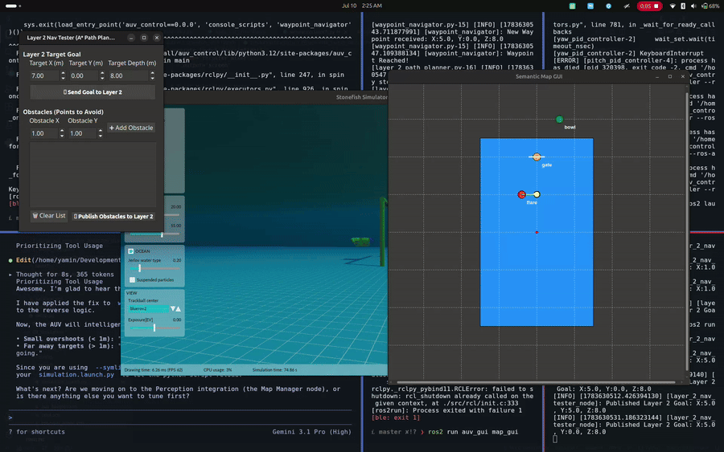

# Makara AUV — ROS 2 Autonomy & Control Stack (SAUVC 2026)


Official ROS 2 autonomy, control, state-estimation, and perception workspace for **Makara**, Team Tiburon's competition Autonomous Underwater Vehicle (NIT Rourkela) built for **SAUVC 2026**.

---

## Live Demos

### 1. Real-World Pool Perception (`makara_vision` — Custom YOLO)
Real underwater pool testing with multi-class bounding-box detection across underwater gate, flare, and target objects:

<p align="center">
  
</p>

### 2. Real-Time 6-DOF Debug Console & 8-Thruster Allocation
Live telemetry from `makara_control_node` (C++ PID), `thruster_mixer` (8-thruster vectored allocation), and `makara_gui` (PyQt5 + PyQtGraph):

<p align="center">
  
</p>

### 3. Stonefish Underwater Simulation & Mission Planner
<p align="center">
  
</p>

### 4. Semantic Map & A* Path Planning
<p align="center">
  
</p>

> **Status & Repo Note:** Simulation, 6-DOF control, EKF, and vision nodes are validated in Stonefish/Gazebo alongside ongoing physical pool trials (see real-world pool perception demo above). Published as a consolidated ROS 2 workspace snapshot across SAUVC 2026 sub-packages.

---

## System Architecture

```
Sensors (IMU + Depth + Camera + DVL)
        │
        ▼
┌───────────────────────────────┐
│  StateSpace (EKF / Comp.)     │  Unified 6-DOF pose & velocity estimate
└───────────────┬───────────────┘
                │
                ▼
┌───────────────────────────────┐
│  makara_vision & Planner      │  Hailo-8L / YOLOv8 gate, flare & buoy detection + A*
└───────────────┬───────────────┘
                │
                ▼
┌───────────────────────────────┐
│  makara_control (C++ PID)     │  6-DOF (Surge, Sway, Heave, Roll, Pitch, Yaw)
└───────────────┬───────────────┘
                │
                ▼
┌───────────────────────────────┐
│  thruster_mixer & serial      │  8-thruster allocation matrix -> STM32 / Pico PWM
└───────────────────────────────┘
```

---

## Workspace Packages (`src/`)

| Package | Language | Role |
| :--- | :--- | :--- |
| `makara_control` | C++17 | 6-DOF PID attitude & depth controller (`makara_control_node`) |
| `auv_description` | Python | Gazebo `pool.world`, `sim_bridge`, 8-thruster `thruster_mixer`, and `makara_gui` |
| `StateSpace` | Python | Extended Kalman Filter (`ekf_node.py`) & complementary filter sensor fusion |
| `makara_vision` | Python | Underwater object detection (`detector_node.py` with Hailo-8L / YOLOv8) |
| `makara_bringup` | Python | Full-stack launch orchestration (`makara.launch.py`) |
| `makara_serial` | Python | Hardware serial bridge to STM32 / Raspberry Pi thruster ESCs |
| `makara_interfaces` | ROS IDL | Custom `Combined`, `Setpoint`, `PID`, `ThrusterForces`, `ThrusterSpeeds` messages |
| `ardupilot_attitude_control` | C++17 | ArduSub attitude controller integration node |

---

## Quick Start

```bash
# 1. Source ROS 2 and build the workspace
source /opt/ros/jazzy/setup.bash
colcon build --symlink-install
source install/setup.bash

# 2. Launch 6-DOF PID controller + setpoint/gain publishers
ros2 launch makara_control makara_control_launch.py

# 3. Launch EKF state estimation (in a second terminal)
ros2 launch StateSpace state_space_launch.py filter_type:=ekf

# 4. Launch real-time Debug Console & thruster mixer
ros2 run auv_description thruster_mixer.py &
ros2 run auv_description makara_gui.py
```
