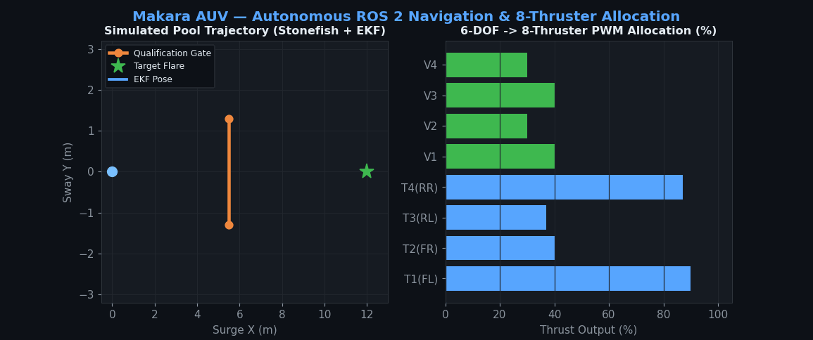

# Makara AUV — ROS 2 Autonomy & Control Stack (SAUVC 2026)


Official ROS 2 workspace for **Makara**, Team Tiburon's competition Autonomous Underwater Vehicle (NIT Rourkela) built for **SAUVC 2026**.

<p align="center">
  
</p>

## System Architecture

```
Sensors (IMU + Depth + Camera + DVL)
        │
        ▼
┌───────────────────────────────┐
│  State Estimation & EKF       │  Unified 6-DOF pose & velocity estimate
└───────────────┬───────────────┘
                │
                ▼
┌───────────────────────────────┐
│  Mission Planner & Vision     │  Gate detection, flare tracking, buoy alignment
└───────────────┬───────────────┘
                │
                ▼
┌───────────────────────────────┐
│  PID / 6-DOF -> 8-Thruster    │  Thruster allocation matrix -> STM32 / Pico PWM
└───────────────────────────────┘
```

## Key Capabilities
- **6-DOF Navigation & Control:** Surge, sway, heave, roll, pitch, and yaw PID control mapped to an 8-thruster vectored configuration.
- **Sensor Fusion:** Combines IMU orientation, pressure-sensor depth, and vision estimates for stable underwater tracking.
- **Underwater Computer Vision:** Real-time gate, flare, and target detection integrated directly into the ROS 2 control loop.
- **Sim-to-Real Validation:** Validated end-to-end in Stonefish/Gazebo underwater physics simulations and real pool trials.
